# Mistu — captures et ajustements de lecture mobile

31 octobre 2026. Comparaison de l’application réelle avant 0.32.10-1 et après 0.32.11-4. Captures 390 × 844, mêmes profils de démonstration et mêmes données. Tous les fichiers ci-dessous ont été ouverts et inspectés. La recette anglaise est un exemple fictif destiné à contrôler la lecture et les langues ; aucun contenu personnel ni appel assistant payé.

Les cinq destinations et toutes les actions restent accessibles. L’identité crème/olive est conservée.

## 1. Accueil

Le titre tient sur une ligne à 390 px. Les exemples de recherche sont de vrais boutons, accessibles par Tab, Entrée et Espace.

| Avant | Après |
| --- | --- |
| 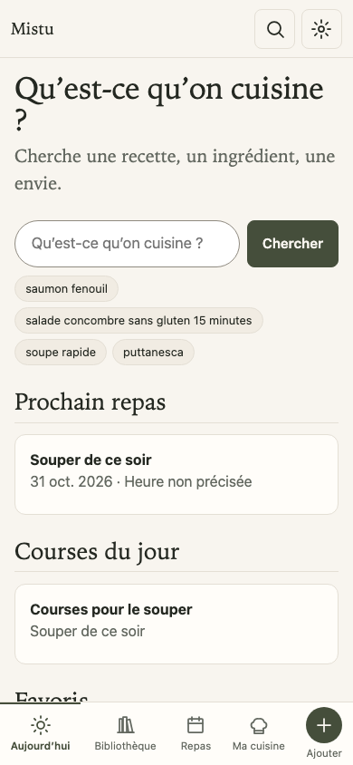 | 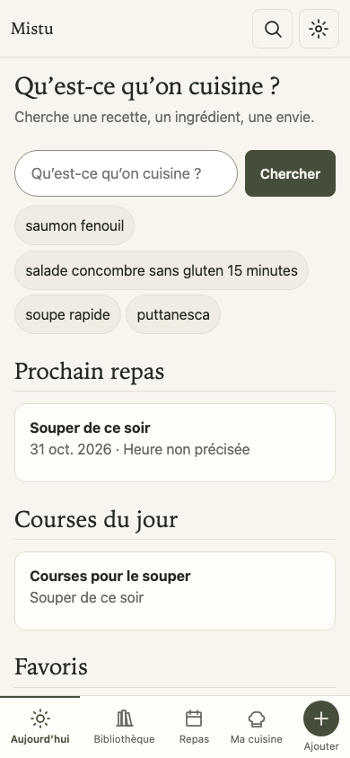 |

## 2. Bibliothèque

Le premier titre de recette apparaît à 593 px au lieu de 818 px. Les images accompagnent les titres ; tri, filtres, sélection et Actions restent disponibles.

| Avant | Après |
| --- | --- |
| 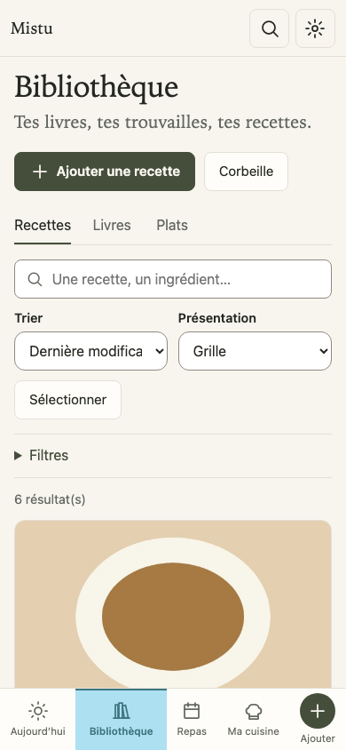 | 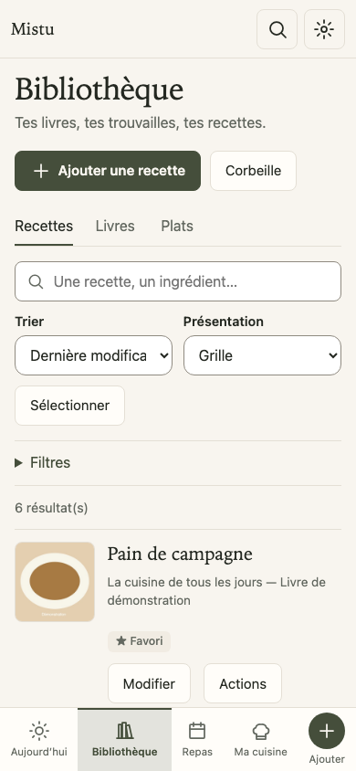 |

## 3. Ajouter

Six choix visibles au lieu de quatre à 390 px : icônes à gauche, textes à droite, espacements réguliers.

| Avant | Après |
| --- | --- |
| 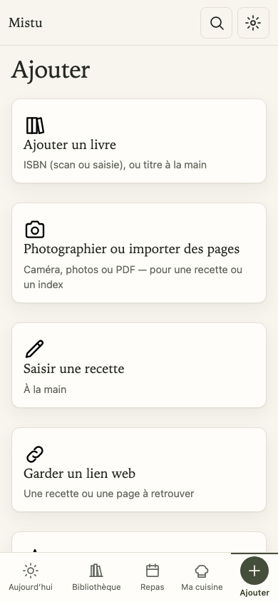 | 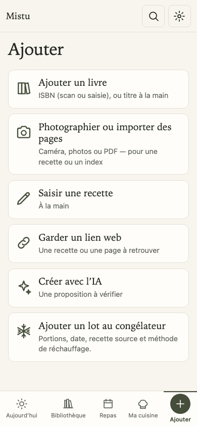 |

## 4. Choix des pages

Structure conservée : destination, type de pages, puis photo ou fichier. Les aides et les boutons étaient déjà lisibles.

| Avant | Après |
| --- | --- |
|  | 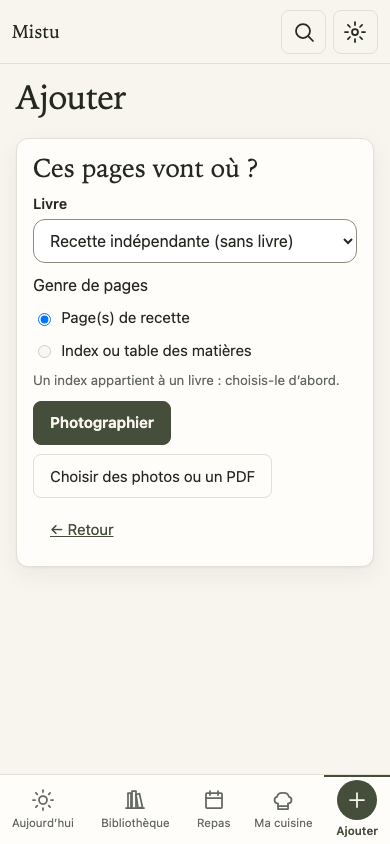 |

## 5. Ajout manuel du livre

Le geste Saisir à la main dirige le focus vers Titre. Le libellé reste visible, y compris sous la barre fixe sur ordinateur ; aucun retour tardif du focus après sauvegarde.

| Avant | Après |
| --- | --- |
| 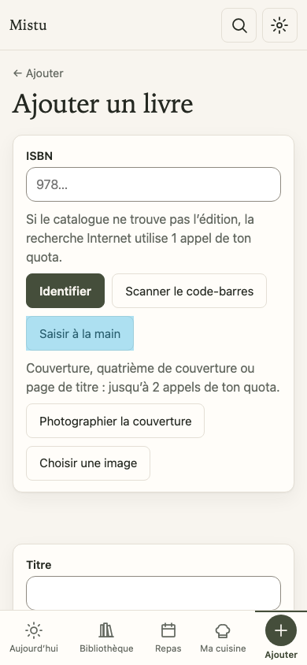 | 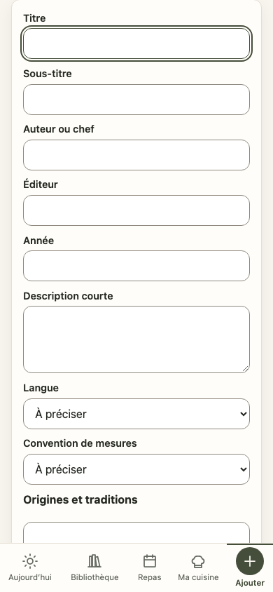 |

## 6. Fiche recette

Commandes secondaires alignées, avec retour à la ligne pour le texte agrandi, Cuisiner clairement séparé. Lire la recette rejoint immédiatement le contenu en conservant langue, version, onglet et ingrédients cochés.

| Avant | Après |
| --- | --- |
| 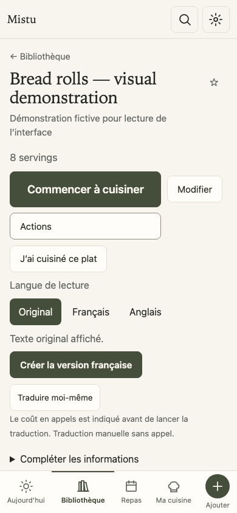 | 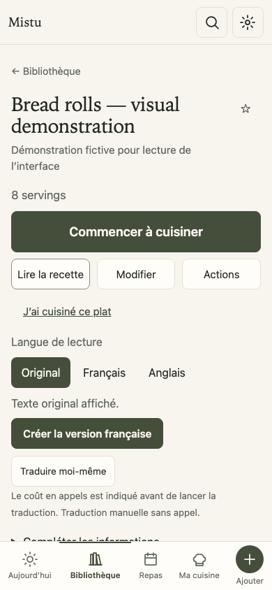 |

## 7. Cuisine

Les options sont repliées ; avertissements et ingrédients restent accessibles. Le premier paragraphe de cette étape est maintenant visible au-dessus de Précédent/Suivant.

| Avant | Après |
| --- | --- |
| 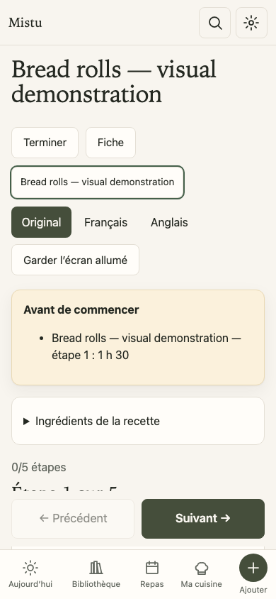 | 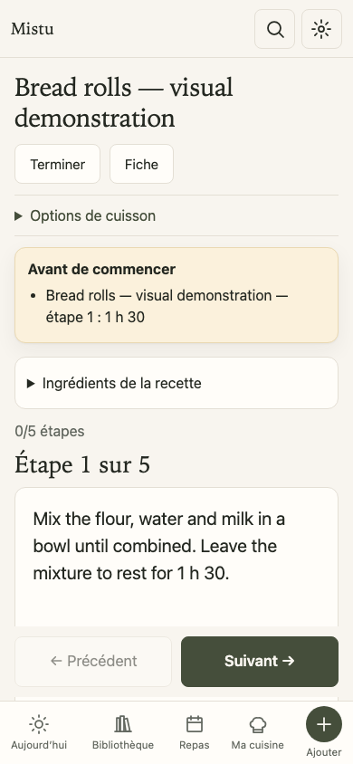 |

## 8. Bilan de cuisson

Formulaire conservé : date, appréciation, observations, portions et photo. Capture stable relue ; aucune refonte du bilan dans cette passe.

| Avant | Après |
| --- | --- |
| 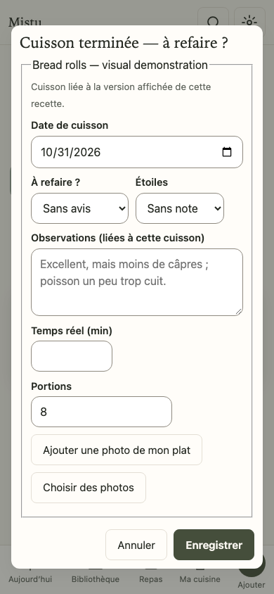 | 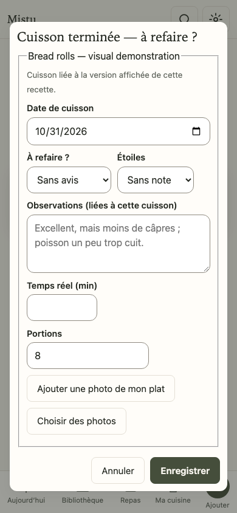 |

## Accès direct à la lecture

Après un appui sur Lire la recette :

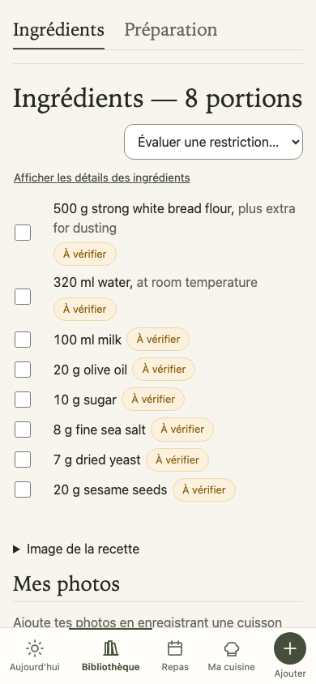

## Vérifications et limites

Captures complémentaires à 320 px et 1280 px, interface anglaise, texte agrandi à 200 %. Pas de débordement horizontal observé sur ces parcours. La recherche reste utilisable en pleine largeur avec le texte agrandi ; les cartes reprennent une disposition verticale si nécessaire. Le repli d’une image illisible conserve un bouton Télécharger entièrement visible et cliquable, vérifié séparément. Les cibles de retour et les nouveaux boutons gardent 44 px minimum.

À320px avec le texte doublé, les boutons de la fiche reviennent à la ligne. En cuisine, les barres fixes restent volumineuses à cet agrandissement ; le texte est atteignable par défilement.

Ces observations et tests clavier ne constituent pas une certification complète d’accessibilité. VoiceOver, appareil photo natif et PWA sur iPhone physique ne sont pas testés. Le formulaire de livre conserve ses champs ; la fiche avec traduction manquante conserve son explication et son parcours de traduction.

[Contrat](../superpowers/specs/2026-10-31-confort-lecture-mobile-design.md) · [Réception technique](../superpowers/plans/2026-10-31-confort-lecture-mobile-reception.md).
