# Mistu — lecture et navigation sur téléphone

31 octobre 2026. Captures fraîches, application réelle et données de démonstration. Les fichiers présentés ont été ouverts et inspectés. WebKit tactile375×667/390×844, paysage667×375/844×390, hauteur400px et texte200%. Chromium sert de témoin et émule les marges sûres latérales. Aucun iPhone physique, clavier iOS ou VoiceOver testé.

Cette passe complète les premiers ajustements : menus réellement tactiles dans WebKit, bibliothèque dégagée, plats visibles dans le repas, bilan ouvert au bon endroit, lecture en paysage et marges du téléphone. Les couleurs crème/olive sont conservées.

## 1. Accueil en paysage — corrigé

Le titre prend moins de hauteur. Le contenu, la marque et la navigation respectent les marges latérales44px émises par le moteur lors de cet essai. Ce sont des zones sûres émulées, pas une encoche physique photographiée.

| Avant | Après |
| --- | --- |
| 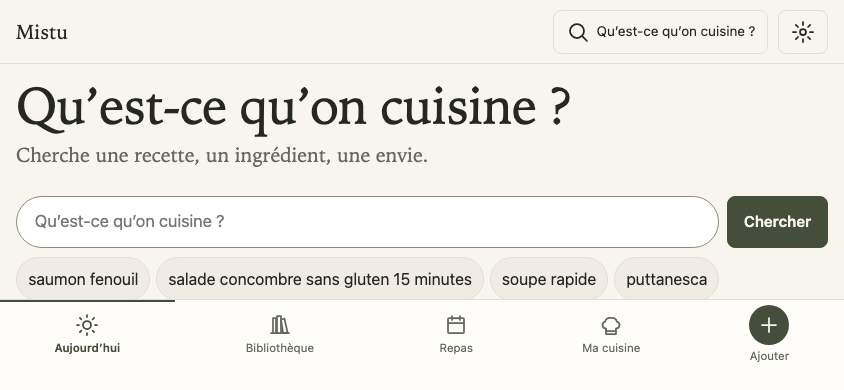 | 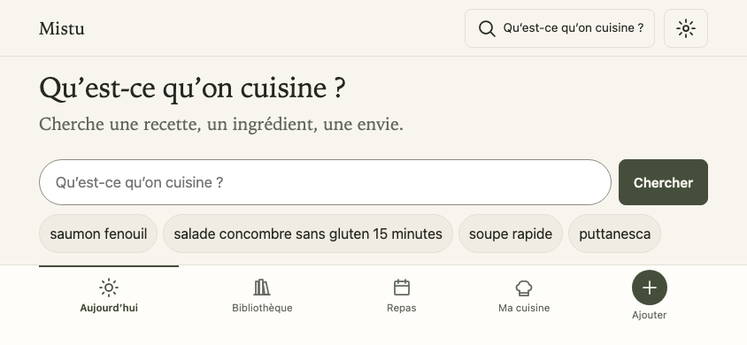 |

## 2. Bibliothèque — corrigée

Recherche directe ; tri, présentation et sélection regroupés dans « Affichage et sélection ». Le premier titre apparaît à524px au lieu de584px : il est entièrement visible au-dessus de la navigation à597px. Les contrôles restent directement visibles sur ordinateur.

| Avant | Après |
| --- | --- |
| 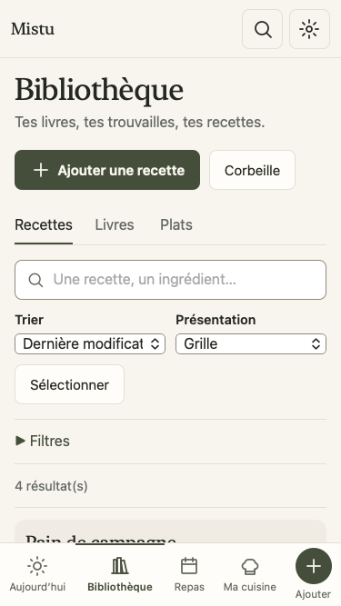 | 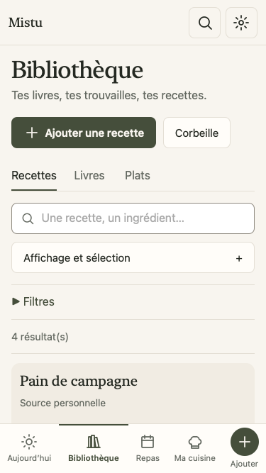 |

## 3. Repas — corrigé

Les portions et la date restent visibles ; les réglages sont dans « Organisation du repas ». Le premier plat remonte de1102 à364px. Ouvrir, enregistrer le jour et recharger conserve le volet ouvert et les données ; fermer enlève uniquement cet état de présentation.

| Avant | Après |
| --- | --- |
| 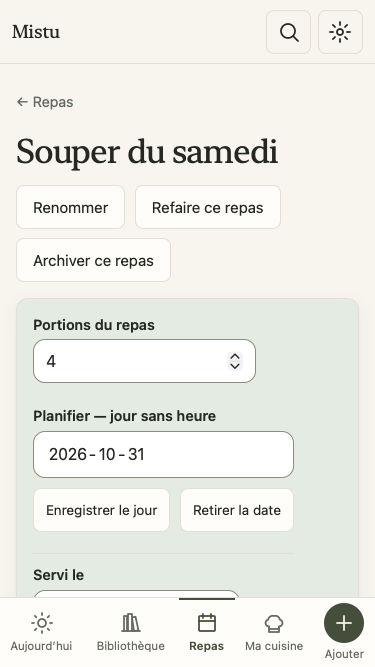 | 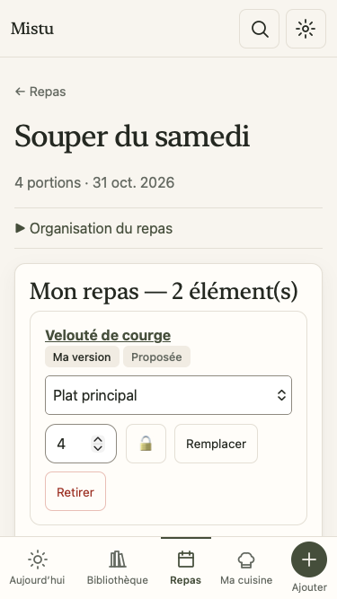 |

## 4. Courses — utilisables, encore chargées

Menus agrandis, case cochée réellement conservée. Les outils Copier/Partager et de classement par rayon restent volumineux ; aucune refonte de leur organisation dans cette passe.

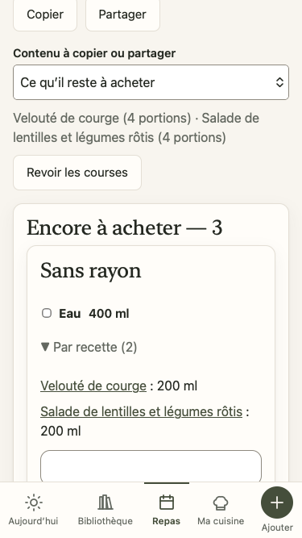

## 5. Ma cuisine — utilisable, cartes encore longues

Menus44px, détails accessibles, stocks conservés lors du parcours. Les trois actions des cartes restent visibles ; leur disposition n’est pas refondue.

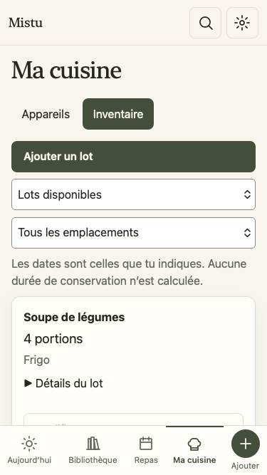

## 6. Ajouter et photo — marges corrigées, commandes accessibles

En paysage, les choix restent dans la zone sûre et le titre est moins haut. Les boutons de photo et les menus Actions restent accessibles après défilement, même avec400px de hauteur disponible. Aucune caméra native utilisée dans cet audit.

| Avant | Après |
| --- | --- |
| 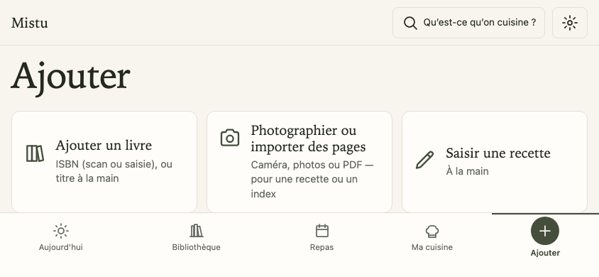 | 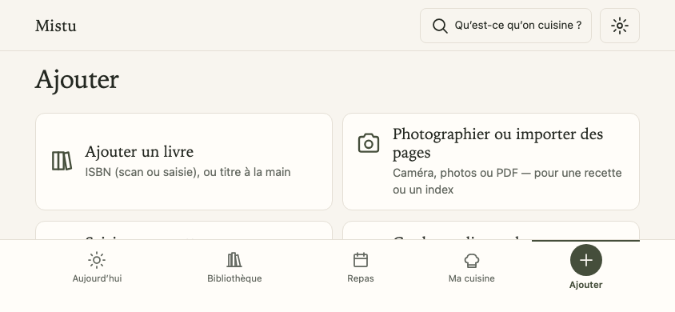 |

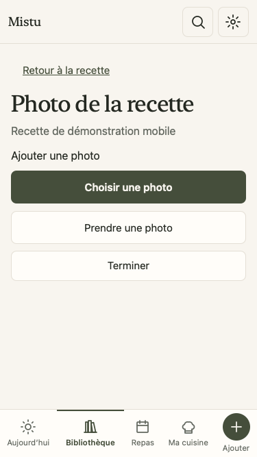

## 7. Livre — menus corrigés

Langue et convention de mesures passent de23 à44px dans WebKit, en gardant leur flèche native. À texte200%, leur hauteur passe à88px. La saisie manuelle conserve l’accès direct au titre ; les champs facultatifs restent présents.

| Avant | Après |
| --- | --- |
| 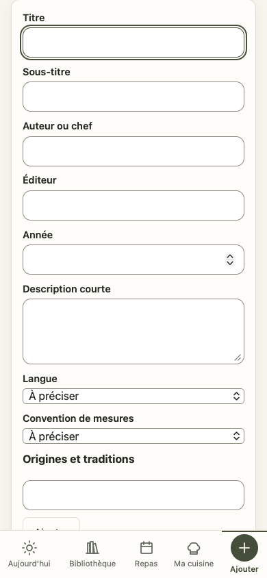 | 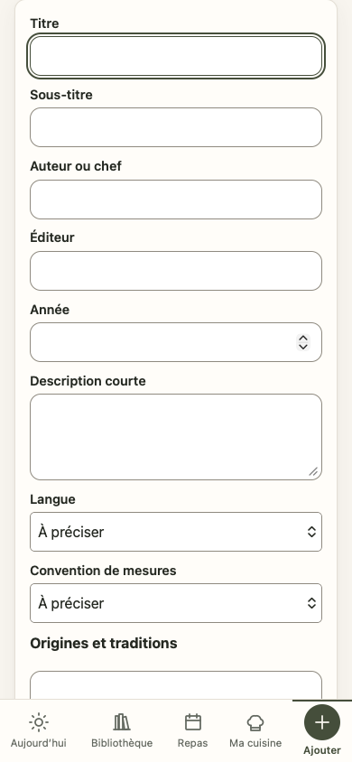 |

## 8. Cuisine — davantage de place pour lire

En paysage court, Précédent/Suivant suit le contenu au lieu de rester superposé :78px de lecture récupérés. Même principe lorsque le texte agrandi place déjà le menu global dans le flux. Les commandes restent accessibles en défilant.

| Avant | Après |
| --- | --- |
| 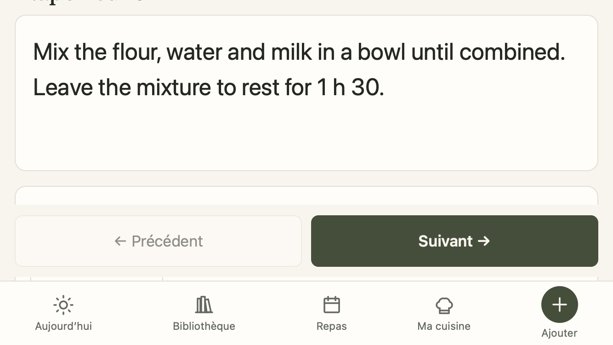 | 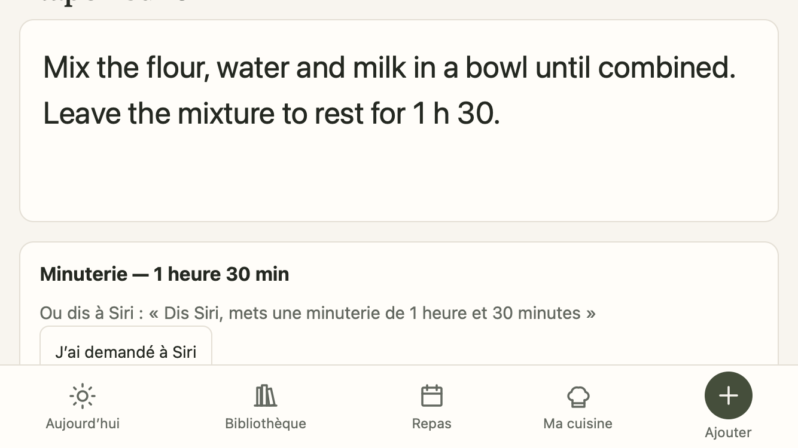 |

L’espace entre les deux barres passe de38 à4px dans le cas simulé avec marge basse34px : cette marge était comptée deux fois.

| Avant | Après |
| --- | --- |
| 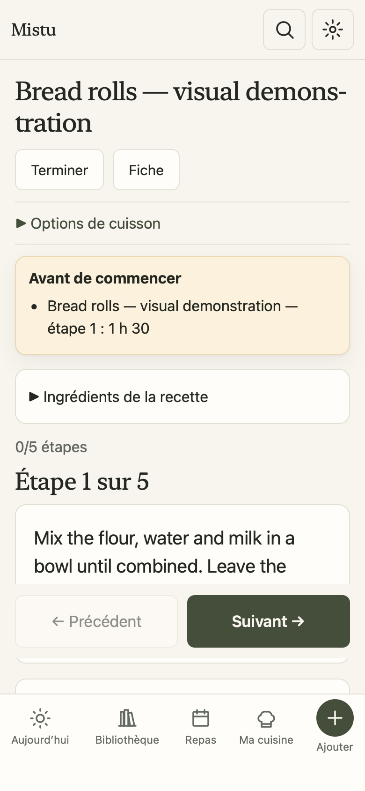 | 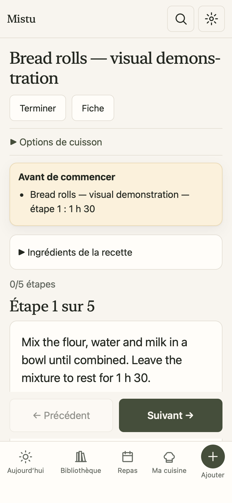 |

## 9. Bilan — ouverture corrigée

Le formulaire s’ouvre maintenant sur son titre. À375×667, il démarrait déjà défilé de110px ; à375×400, de377px. Il démarre désormais à0. Annulation et données conservées sont vérifiées.

| Avant | Après |
| --- | --- |
| 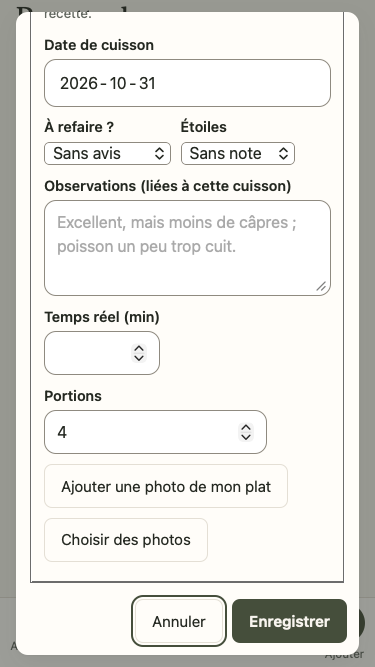 | 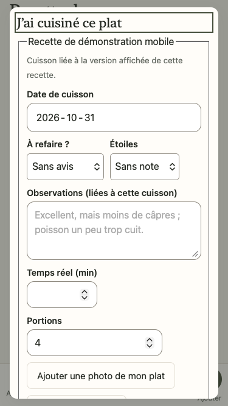 |

## 10. Réglages — vérifiés, organisation conservée

Préférences et sauvegarde restent accessibles. L’écran demeure long et la sauvegarde riche en texte technique ; ce parcours n’est pas réorganisé ici.

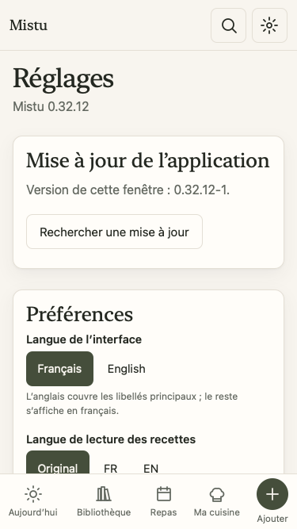

## Portée des preuves

Les captures proviennent de cette passe uniquement. Les premières images après modification sont prises sous0.32.12-1 ; le raccord de conservation du volet est reçu sous0.32.12-2, puis sa garde de sortie est ajustée sous0.32.12-3, avec disposition initiale inchangée. Les menus natifs Date peuvent encore tronquer leur valeur à texte200% : ce point n’est pas corrigé ici. Les sélecteurs simples et la navigation sont contrôlés séparément. Aucune certification complète d’accessibilité ni preuve sur matériel iPhone n’est revendiquée.

[Contrat](../superpowers/specs/2026-10-31-pwa-mobile-design.md) · [Réception technique](../superpowers/plans/2026-10-31-pwa-mobile-reception.md).
