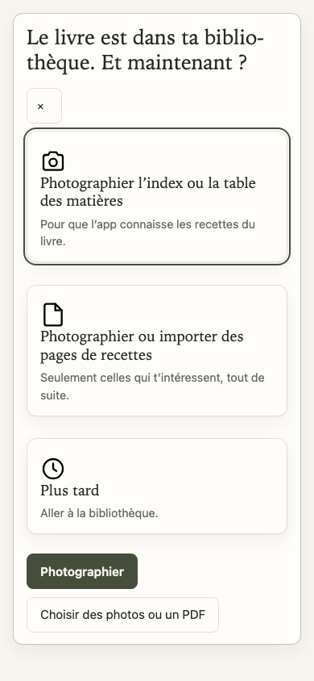
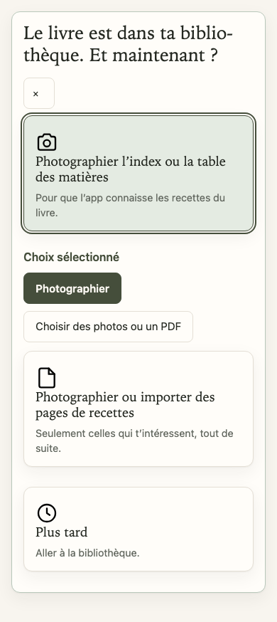
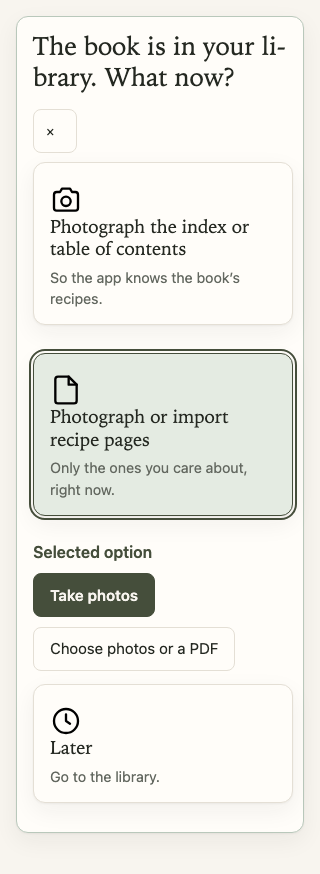
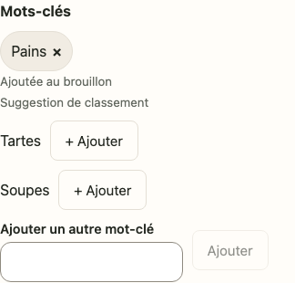
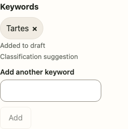
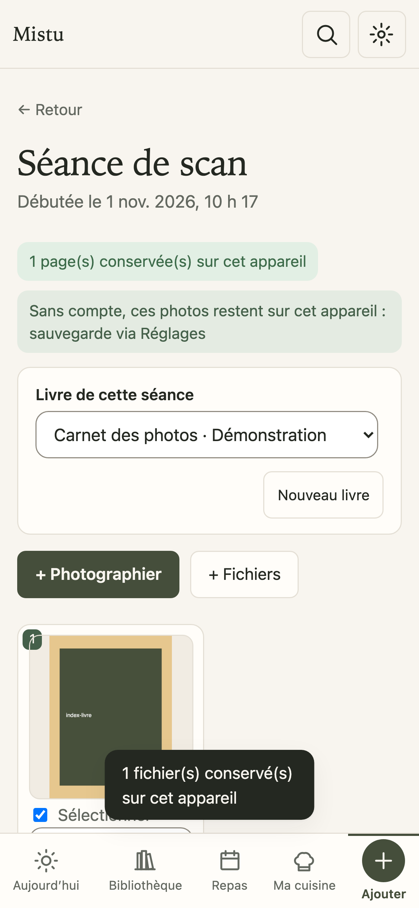
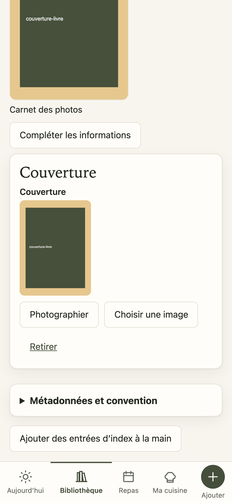

# Boutons photo et suggestions — captures relues

1er novembre 2026. [Spec acceptée](../superpowers/specs/2026-11-01-boutons-photos-suggestions-design.md) · [Réception technique](../superpowers/plans/2026-11-01-boutons-photos-suggestions-reception.md).

## Commandes photo auprès du choix

Avant, les commandes apparaissaient après les trois cartes, sous « Plus tard ». Maintenant, elles suivent la carte sélectionnée. L’état est nommé et annoncé par `aria-pressed`, avec des boutons natifs. Entrée/Espace sélectionnent la carte ; Tab passe aux commandes de cette carte.

| Avant, français 390 px | Après, français 390 px |
| --- | --- |
|  |  |

Ces vues utilisent le vrai composant d’accueil avec données fictives. Elles ne prouvent pas l’ouverture de la caméra d’un iPhone. L’ouverture native et la conservation sont vérifiées séparément dans les parcours de réception.

## Suggestions et valeurs retenues

Une valeur retenue porte « Ajoutée au brouillon », sa provenance sur une autre ligne et une seule croix de retrait. Les propositions encore disponibles ont chacune leur bouton « + Ajouter ». Le champ libre porte son propre libellé ; Ajouter reste désactivé lorsqu’il est vide.

| Français 390 px, propositions disponibles | Anglais 320 px, après enregistrement et réouverture |
| --- | --- |
|  |  |

Les quatre combinaisons français/anglais et 320/390 px passent 40 contrôles visuels et de parcours. Les cibles de retrait mesurent au moins 44 px et aucun débordement horizontal n’est constaté. Ajout, retrait, sauvegarde finale et nouvelle lecture préservent les autres catégories et les sources.

Une première inspection a révélé les mentions d’état et de provenance collées dans un élément inline ; la correction CSS les sépare. Les captures ci-dessus sont celles du résultat corrigé, ouvertes pour inspection. Elles ne sont pas des maquettes générées.

## Photos réellement conservées

Le parcours complet de l’application passe 25 contrôles sur la livraison 0.32.13-2, en Chromium tactile 390 × 844. Quatre JPEG de démonstration traversent les vraies routes : index, pages de recette, couverture et photo du plat. Chaque entrée est annulée deux fois puis rouverte. Les fichiers sont ensuite relus après un vrai rechargement hors ligne.

| Page d’index conservée | Couverture retrouvée hors ligne |
| --- | --- |
|  |  |

Les annulations de ce parcours utilisent un événement DOM sur le véritable input ; les choix passent par le sélecteur intercepté par Playwright. Aucun compte privé ou appel payé. La caméra, les permissions et la PWA installée sur un iPhone physique restent à recevoir sur appareil.
