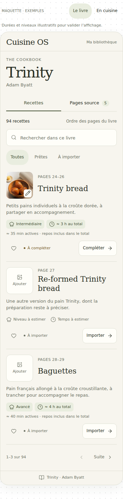
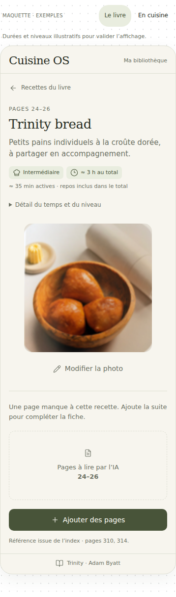
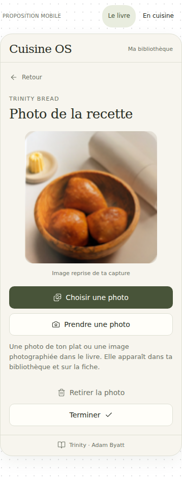

# Mito — Ajustements de l’interface visuelle

**28 octobre 2026 — Complément consacré à l’affichage et à l’utilisation des recettes.**

## Ce qu’on veut voir pour chaque recette

Une photo, le nom original, une courte description en français, le niveau de difficulté et le temps à prévoir. Ces informations doivent permettre de comprendre le plat et de décider rapidement si on veut le cuisiner.

## Description courte, style menu de restaurant

- Ajouter sous chaque titre **une ou deux phrases courtes**, en français, d’environ 15 à 25 mots. Viser deux lignes dans la liste; afficher le texte complet dans la fiche.
- Dire simplement de quel plat il s’agit, avec ses ingrédients principaux ou sa préparation caractéristique. Expliquer les noms italiens ou les termes peu connus sans remplacer le titre original.
- Employer un ton de menu clair et appétissant, sans formules publicitaires ni longue histoire du plat.
- L’IA prépare cette description à partir du contenu disponible. Ne pas inventer une garniture, une sauce ou une technique. Si le titre seul ne suffit pas, afficher « Description à compléter » jusqu’à la lecture de la recette.
- Permettre une correction manuelle et la conserver lors des mises à jour.

**Exemple de ton :** *Ravioli ricotta e spinaci* — « Pâtes farcies à la ricotta et aux épinards, pour un plat doux et crémeux. »

## Difficulté estimée

Afficher un niveau distinct du temps de réalisation :

| Niveau | Ce que cela indique |
| --- | --- |
| Facile | Gestes simples, peu de préparations à coordonner. |
| Intermédiaire | Quelques techniques et plusieurs étapes à organiser. |
| Avancé | Gestes précis, cuisson délicate ou coordination soutenue. |
| Chef | Techniques expertes, plusieurs préparations complexes ou matériel spécialisé. |

Le niveau est estimé à partir des étapes, des techniques et du matériel requis. Dans la fiche, une courte explication peut préciser ce qui rend la recette exigeante. Si les informations sont insuffisantes, afficher « Niveau à estimer ».

## Temps à prévoir

- Afficher **le temps total** dans la liste et distinguer **le temps actif** dans la fiche, également visible en petit dans la liste.
- Le total comprend la préparation, la cuisson et les attentes nécessaires : repos, levée, marinade, refroidissement. Tenir compte des étapes qui peuvent se faire en parallèle.
- Reprendre les durées explicites du livre; pour une estimation de l’IA, utiliser « ≈ » ou une fourchette et l’indiquer comme estimée. Permettre une correction manuelle.
- Exemple d’affichage : **Intermédiaire · ≈ 3 h au total**, puis **≈ 35 min actives · repos inclus**.
- Ajouter le badge **« Rapide »** si le temps total est de **30 minutes ou moins**. Ce badge complète le niveau de difficulté. Une préparation courte avec plusieurs heures de repos n’est pas classée rapide.
- Si le contenu manque, afficher « Temps à estimer » plutôt qu’une durée inventée.

## Photo et présentation mobile

- Miniature du plat dans la bibliothèque; grande photo sur la fiche; accès à l’image en mode cuisine.
- Commandes **« Choisir une photo »**, **« Prendre une photo »**, **« Modifier la photo »** et **« Retirer la photo »**. Sans image, afficher un emplacement explicite « Ajouter une photo ».
- Conserver la photo après réouverture et mise à jour de la recette. La photo du plat et les pages à lire par l’IA ont des commandes distinctes.
- Garder la palette crème et olive. Laisser les titres se lire normalement; placer les actions sous les informations. Pour une recette partielle, afficher « Compléter ».
- En mode cuisine, mettre l’étape courante au premier plan, replier les ingrédients et garder Précédent/Suivant accessibles. Garder la minuterie simple et claire.
- Conserver l’accès visuel à **« Pages source »**, **« Ajouter des pages »** et **« Mettre à jour avec l’IA »** depuis la fiche du livre.

## Maquettes jointes

[Ouvrir la maquette interactive](Mito_Interface_Visuelle.html).

### Liste : photo, description, difficulté et temps

### Fiche du pain

### Ajouter ou remplacer la photo

La photo du pain provient de la capture fournie. **Les durées et niveaux de la maquette sont des exemples d’affichage, pas des évaluations validées des recettes de Trinity.** L’extraction est simulée; les photos choisies dans la maquette restent en mémoire pendant la navigation.

Conserver le MD, la page HTML et les PNG ensemble pour afficher les images et ouvrir la maquette.
